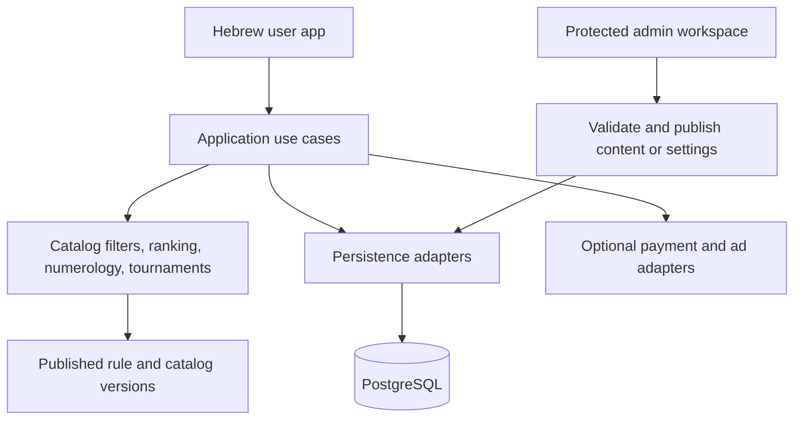

# שם המשחק implementation plan

Draft for review · 27 October 2026

Build a Hebrew name-discovery web app whose content, recommendation rules, and presentation can evolve independently. The product owner should be able to maintain the name catalog and release settings through an admin workspace; developers should have a readable codebase, repeatable data imports, and a safe release process.

This plan covers the app, its management tools, data quality, and delivery sequence. It is a proposal, not authorization to deploy or activate paid services.

## What the sketch contains

The [working Claude artifact](https://claude.ai/artifact/24zPHfCsJ5udHxtsXMcW5Q) was reviewed through its rendered screens and interactions. Its source code and underlying catalog have not been exported.

| Area | Observed behavior |
| --- | --- |
| Search setup | Baby names; boy, girl, and unisex choices; first or middle name; liked or family names; optional surname; numerology filters |
| Discovery | One name at a time, like/pass actions, origin and popularity labels, expandable meaning and statistics |
| Lists | Saved and passed names, manual name entry, removal and tournament entry |
| Tournament | Pairwise elimination, up to the last 16 saved names, a winner and leading names; losers move into the passed list |
| Profile | Family names, an emerging style summary, premium entry point, device-only storage and data reset |
| Search management | Multiple searches and return to an existing search |
| Monetization sketch | Sample timed ads and a simulated one-time ₪18 premium option |
| Future features | Pet names and partner connection/comparison are labeled as future features |

The sketch labels its catalog as 3,531 names from the Israeli Central Bureau of Statistics. That is a prototype claim to reconcile against the actual import, rather than a verified production inventory. Meanings, labels, and statistics need their own provenance checks.

## Working scope and open decisions

The proposed first release is a mobile-oriented Hebrew web app for an individual parent. It includes the complete discovery, shortlist, tournament, and saved-search loop, plus a small admin workspace. Partner matching, pet names, advertising networks, and real checkout follow in separate increments.

The following decisions remain open:

- Individual use first, or partner matching at launch.
- Admin editing plus source ownership, or source-only management initially.
- Technology and hosting preferences; the stack below is proposed.
- Guest-only beta versus optional sign-in and recovery at launch.
- Whether the sketch's price and ad placements should survive into the commercial version.

The first three choices have been requested from the product owner. Until answered, these defaults guide planning only.

## Product behavior to settle before implementation

1. **Keep favourites independent of tournament results.** Losing a comparison should record a result without removing a liked name. Offer an explicit action if someone wants to move losers to the passed list. Show the tournament entrants before starting, rather than silently using the latest 16.
2. **Make actions reversible.** Provide undo for like/pass, restore for passed names, and clear confirmation for a full reset. Preserve interrupted searches and tournaments.
3. **Define filter semantics.** Decide whether “boy” includes names also used for girls, what qualifies as unisex, and whether multiple selections combine. Show the remaining result count and offer filter changes when nothing matches; never silently relax a filter.
4. **Give middle-name searches a purpose.** Ask for the existing first name when relevant, then preview first + middle + surname. Keep surname entry optional. Use explicit combination rules rather than claiming an unsupported compatibility score.
5. **Distinguish family context from taste.** A relative's name might be an inspiration or an exclusion. Store that intent explicitly rather than treating every family name as a positive preference.
6. **Keep user-added names private.** Manual entries work in shortlists and tournaments without becoming public catalog records. Do not invent origin, meaning, or popularity for them.
7. **Preserve the recognizable identity.** Retain the Hebrew name, conversational voice, name-card focus, warm colors, and bold playful controls as the starting reference. Use reusable tokens for later visual changes. A visual redesign is a separate decision.

## Proposed architecture

Use one application with clear module boundaries and one database. Separate services and a large monorepo would add overhead at this scale.

- **Next.js with React and TypeScript** for the public app, authenticated admin routes, and server endpoints. This keeps one language across UI and domain code. Next.js supports self-hosting, allowing the hosting choice to remain open. [Next.js self-hosting guide](https://nextjs.org/docs/app/guides/self-hosting)
- **PostgreSQL through Supabase** for structured data and authentication. Protect private records with explicit ownership policies and keep privileged operations on the server. [Supabase data security guide](https://supabase.com/docs/guides/database/secure-data)
- **A small shared component system** for Hebrew RTL forms, buttons, cards, dialogs, and navigation. Centralize colors, fonts, spacing, motion, and Hebrew copy.
- **Vitest and Playwright** as proposed unit and browser-test tools. Select supported versions when implementation starts and commit the dependency lockfile.

Keep framework, database, payment, and ad APIs out of the core numerology, ranking, and tournament functions. Use ordinary module interfaces around external providers so they can be changed without rebuilding the product logic.



Proposed code organization:

```text
src/app/                    Routes, layouts, server endpoints, admin entry points
src/features/searches/      Search setup and saved searches
src/features/discovery/     Card browsing, decisions, undo
src/features/shortlist/      Saved/passed lists and custom names
src/features/tournaments/   Entrant selection, matches, results, resume
src/features/profile/       Family context, style, account management
src/features/admin/         Catalog, import review, configuration, publishing
src/domain/                 Pure filters, ranking, numerology, tournament rules
src/data/                   Database access and external-provider adapters
src/ui/                     Shared components, design tokens, Hebrew copy
supabase/migrations/        Versioned schema and access policies
scripts/import/             Catalog ingestion and validation
tests/                      Domain, integration, and browser tests
docs/                       Product decisions and operating instructions
```

Routes and UI components should call use cases rather than duplicate rules. Start with the interfaces actually needed; avoid building a general plugin framework.

## Data model and ownership

| Record | Responsibility |
| --- | --- |
| Catalog name and aliases | Stable ID, display spelling, search normalization, reviewed classification, publication status |
| Editorial content | Meaning, origin, style tags, source references, review state and revision |
| Popularity observation | Name, birth year, population scope, source category, count, import reference; explicit missing or suppressed values |
| Source and import batch | Original file reference, publication date, checksum, transformation version, import review |
| User and search | Owner, search purpose, filters, surname and context; each search has independent preferences |
| Private custom name | Owner, spelling, optional notes; usable alongside catalog names |
| Decision and current preference | Like/pass/restore events plus current state; sufficient history for undo and deduplication |
| Tournament and match | Frozen entrants, ordering seed, rule version, progression, choices and result |
| Configuration revision | Validated ranking weights, feature availability, gate rules and release status |
| Admin audit event | Actor, operation, before/after revision and timestamp |
| Later commercial or partner records | Verified entitlements and payment events; partner membership and invitations when those features are built |

Use stable IDs for preferences and results so editing a name's display text does not break saved data. Archive catalog entries rather than destroying references. Keep imported statistics separate from editorial overrides so an updated source file cannot erase reviewed content.

## Name data and recommendation rules

**Import and review.** Start with a small reviewed catalog to prove the full flow, then import the intended complete dataset through the same pipeline. Preserve raw source files, record transformations, detect duplicates and spelling variants, preview changes, and reconcile row counts before publication. Re-importing the same file must not duplicate data.

**Statistics.** Record birth year and population scope beside every number. Preserve missing/suppressed values rather than converting them to zero. Define popularity labels and peak-year calculations explicitly. The CBS publication distinguishes population groups, spelling normalization, and first-name handling, which affect how statistics can be presented. [CBS names publication for children born in 2024](https://www.cbs.gov.il/he/mediarelease/DocLib/2025/391/11_25_391b.pdf)

**Editorial content.** Meanings and origin labels need reviewed references independently of numerical data. Allow “meaning not yet reviewed” rather than generating an unsupported explanation.

**Ranking.** Apply hard filters first, then rank with a small documented set of signals: stated interests, reviewed style tags, prior likes, and a controlled exploration allowance. Avoid repeatedly showing passed names. Begin with transparent rules; introduce a learned model only if measured results justify it. Provide an admin preview explaining why a name ranked highly and which rule version produced that order.

**Numerology.** Implement the sketch's stated method as a pure function: standard Hebrew gematria, final letters valued like their regular forms, reduced to one digit. Specify handling of niqqud, separators, compound names, and unsupported characters. Default to the candidate name; a surname should not alter the calculation unless a separate full-name option explicitly says so. Store the method version and present interpretations as numerology tradition.

**Tournaments.** Freeze the entrant set at creation, support non-power-of-two counts through explicit byes, and define the minimum and maximum entrants. Resume safely after interruption and reject duplicate match submissions. Keep match outcomes separate from browsing preferences. Label bracket placements as tournament outcomes rather than implying a precise ranking that the comparisons did not establish.

## What the owner can control

The initial admin workspace should provide:

- Search, edit, review, publish and archive catalog names and editorial fields.
- Import preview with validation errors and a downloadable reconciliation report.
- Manage tags, popularity thresholds, and bounded ranking weights.
- Preview recommendations against sample preference profiles before publishing changes.
- Enable or disable prepared features and monetization gates from a single policy model.
- Review a small dashboard showing search starts, first saves, shortlist creation, tournament completion and explicit “we chose a name” feedback.
- Publish a revision, inspect its change history and restore a previous content or configuration revision.

Use draft → preview → publish rather than making every admin edit immediately public. Publishing and audit recording should succeed together. Running tournaments retain their original rules and entrants. Database restoration remains a separate operation from content rollback.

Keep layout changes and new behavior in reviewed code. An admin setting should change a supported rule or value, rather than permit arbitrary executable code. Avoid building a page editor or unrestricted rules language initially.

## Persistence, access and monetization

**Guest experience.** Let visitors try discovery before registration. For an initial guest beta, save locally with a versioned storage format and make the device-only limitation clear. Provide export/import and recovery from malformed data. Treat optional sign-in as the point where saved searches gain account recovery and device sync.

**Cloud storage.** When sign-in is included, migrate local data through an explicit, repeatable merge. Deduplicate decisions and custom names and define how competing changes resolve. Enforce owner access in the database and server, including for admin endpoints. Do not let one person's authenticated responses enter another visitor's cache.

**Personal context.** Keep surnames and family names out of analytics and routine logs. Collect aggregate product events, not raw family information. Provide user export and deletion when cloud accounts launch.

**Commercial features.** Centralize access decisions so all screens agree about premium and ad unlocks. Keep sample ads and simulated premium clearly confined to development/demo mode. Leave real monetization disabled in the first functional beta. Before commercial launch, choose a provider and confirm the offer; grant paid access only after a verified server-side payment event, with duplicate-event handling and entitlement revocation support. Rewarded ads likewise require provider-supported completion verification and clear handling when an ad cannot load.

**Partner matching later.** Add explicit, expiring invitations, authenticated membership, revocation, and a documented choice about which preferences are shared. Reveal mutual likes only according to that agreed policy. A relationship should not automatically expose every passed name or family note.

## Delivery sequence and acceptance gates

| Phase | Deliverable | Acceptance gate |
| --- | --- | --- |
| 1. Product and data contract | Resolve launch scope; record rules, source inventory, schema and screen flow; recover artifact source/data if available | Every sketch feature is mapped to a build phase; data sources and unresolved choices are visible |
| 2. Working core | RTL shell, search setup, discovery, reviewed seed catalog, lists, private names, undo, local persistence, tournament and result | A fresh visitor can complete the loop, reload midway and resume without losing progress |
| 3. Management and full catalog | Admin login, catalog editor, import pipeline, draft/publish history, settings and recommendation preview | Owner edits and publishes a name and a rule, verifies the result and rolls back; repeat imports remain clean |
| 4. Recoverable accounts | Optional sign-in, cloud persistence, guest migration, export/deletion and clear sync behavior | User can recover on another device; other users cannot access the records; migration cannot duplicate data |
| 5. Launch preparation | Mobile/desktop accessibility review, operational metrics, error reporting, backups and preview release process | Critical tests pass, restore procedure is demonstrated and a reviewable release candidate exists |
| 6. Growth increments | Partner matching, verified monetization and later pet-name catalog as separately scoped features | Each feature meets its own access, data and end-to-end behavior checks before activation |

If partner matching is required at launch, move authenticated accounts and partner records into the initial core rather than simulating them with local storage. If cloud recovery is required for the first public release, phase 4 is part of that release gate. The reviewable beta can otherwise precede it.

Build one complete vertical slice before filling out the catalog and secondary screens. Avoid schedules or effort estimates until the launch scope and available data are confirmed.

## Verification and release control

- Unit-test meaningful rules: Hebrew normalization and numerology, filter combinations, recommendation exclusions, tournament byes/progression and undo.
- Test data integrity: repeat imports, aliases, preserved editorial overrides, missing statistics and stable references after catalog revisions.
- Browser-test the real user loop, no-result filters, empty/one-item lists, a three-name tournament, interrupted sessions and storage recovery. Add account migration and payment-webhook tests when those features exist.
- Test access boundaries: one user cannot read or mutate another's records; ordinary users cannot publish catalog/settings or grant premium.
- Review Hebrew RTL layouts on small phones and desktop, mixed Hebrew/Latin text, keyboard use, screen-reader labels, dialog focus, large text and reduced motion. Gestures must have visible button alternatives.
- Keep code, migrations and configuration history in Git. Use separate development, preview and production environments; run required checks before promotion. Maintain content exports and a tested database backup/restore procedure.

Measure improvements against the actual job: reaching a useful shortlist and making a naming decision. Review the funnel and user feedback before changing recommendation weights or adding new gates. Record the reason, expected outcome and rule version of each change so improvements can be evaluated and reverted.

## First implementation milestone

After the plan is accepted, build one search → name card → like/pass → shortlist → tournament → result path, with reliable reload/resume and a reviewed seed dataset. Include a minimal protected catalog-edit/publish path to prove owner control. Establish those foundations before importing the full catalog or integrating payments.
